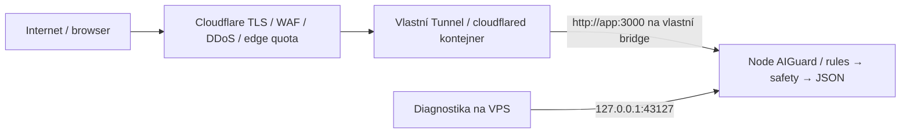

# AIGuard / Věřím? — samostatný cloudový deployment

Aktuální rozhodnutí (2026-10-08): domácí deployment se ruší. Cíl je nové, dosud neobjednané VPS Ubuntu Server 24.04 LTS amd64, 2 vCPU / 4 GB RAM / 40–80 GB SSD, Docker Compose, Cloudflare DNS/WAF/Tunnel, https://verimtomu.fyi. Žádné propojení s domácími projekty/Tailscale. Neproběhl deployment, DNS/tunnel změna, tvorba secrets, objednávka ani push.

**Veřejný release je blokován do uzavření všech P0/P1 v [Security Release Gate](security/SECURITY_RELEASE_GATE.md).** Lokální PASS není schválení produkce.

## Skutečný stack a runtime

Node24, nativní HTTP/SQLite, ES modules, bez externích npm dependencies. Frontend HTML/CSS/JS/14 schválených PNG obsluhuje stejný proces; žádný bundler, dist, frontend build nebo oddělená frontend service. npm ci --ignore-scripts, npm test, npm run check. Vývoj npm start (Node --use-env-proxy src/server.js), HOST127.0.0.1/PORT3000/AI_MODErules; .env se automaticky nenačítá.

Dockerfile: pinned Node builder s offline ci/test/check, pinned distroless Node24 runtime UID65532, bez shellu/npm/docs/tests/Git/env. CMD node --import ./scripts/production-guard.js src/server.js, health Node fetch. Dockerfile.cloudflared kopíruje přesné bajty staticky linkované vendor binárky z pinned upstream do pinned distroless-static s CA. Odstraněním nepotřebného OpenSSL řeší dvě HIGH CVE bez změny connector binárky. Image identity je schválený Git SHA, všechny upstream bases mají digest.

## Architektura a porty



App/connector vlastní privátní Docker bridge, connector navíc vlastní egress bridge. Cloudflared bez host ports/socket/hostnet. Jeho localhost není host/app: route musí být http://app:3000. App má pouze host map 127.0.0.1:43127:3000, Docker28+ povinný kvůli starším loopback/LAN leakům. Trusted API peer je přesná IP connectoru; host diagnostic port API neautentizuje ani s forged CF headerem. Bridge má outbound NAT, není egress sandbox nebo kryptografická autentizace peeru.

Na VPS není nutné veřejné 80/443: HTTP/HTTPS obsluhuje Cloudflare. TCP22 SSH pouze admin source CIDR v provider i host firewallu, IPv4 i IPv6. 3000/43127/metrics20241 nikdy veřejně. Egress Tunnel7844 UDP/TCP + DNS/čas/HTTPS updates/registry. Žádná A/AAAA aplikace na VPS/domácí IP. <VPS_IP>, <ADMIN_CIDR> a <TUNNEL_UUID> dodá člověk, nic se nehádá.

## Konfigurace a hardening

Compose app: UID65532, read-only, cap_drop ALL, NNP, init, restart unless-stopped, RAM512 MiB / CPU0.5 / PID64, tmpfs16 MiB noexec, logs10 MB×3, rules health, stop grace15s. Connector obdobně RAM256 MiB / CPU0.25 / PID64 / tmpfs8 MiB / logs5 MB×2 / private ready probe. Žádné privileged/hostnet/socket/host mounts kromě jediného connector secretu. SIGTERM drain10s; není zero downtime. Docker unhealthy sám nerestartuje — nutný alert.

Backend: fixed origin+Host/Fetch metadata/valid session pro production POST, JSON64KiB/UTF8, body5s/headers10s/outer analysis25s, IP20/min/session10/min/globalAPI600/min, HTTP64 aktivních/128 spojení/8 analýz včetně čtení body; strict routing/methods/headers/native parser. CSP jen skutečné same-origin frontend dependencies, Secure/HttpOnly/Strict cookie, no-store. Žádné body/result logy, user-generated HTML, wildcard /assets/**, aktivní AI/upload/URL fetch/admin/share flow.

app.env z deploy/env/app.env.example: rules, zero budgets, retry0/criticfalse/localfalse/botfalse, bez AI secrets, GUARD_PUBLIC_ORIGIN=https://verimtomu.fyi. Guard blokuje nesprávný/insecure/AI režim. deployment.env drží schválené app/connector SHA, pinned builder/runtime/vendor/static digesty a nekolizní IPAM. Přesná VERIM_INGRESS_IP → GUARD_TRUSTED_PROXY_IP, bez CIDR fallbacku. Token pouze /opt/verimtomu/secrets/cloudflared-token, owner65532/mode0400, mimo Git a app image. Env dirs restricted a ignorované Gitem.

## Realizace a runbook

Úplný bootstrap Ubuntu/SSH/firewall/Docker/updates/backup/deploy/rollback/restore/incident: [OPERATIONS.md](security/OPERATIONS.md). Ruční Cloudflare DNS/Tunnel/WAF/HSTS/Turnstile/tarif a client-IP boundary: [CLOUDFLARE_SECURITY.md](security/CLOUDFLARE_SECURITY.md). STRIDE: [THREAT_MODEL.md](security/THREAT_MODEL.md). Skutečné testy a skeny: [VALIDATION_REPORT.md](security/VALIDATION_REPORT.md). AI/upload/URL/privacy gates: [DATA_AND_FEATURE_GATES.md](security/DATA_AND_FEATURE_GATES.md).

DNS: proxied apex CNAME verimtomu.fyi → <SKUTECNY_TUNNEL_UUID>.cfargotunnel.com, hostname http://app:3000, catch-all404, edgeTLS+HTTPredirect+postupný HSTS. Žádný wildcard hostname, starý tunnel nebo token. Cloudflare ukončuje TLS a musí být v privacy zpracovatelích. WAF nesmí cacheovat API, logovat obsah nebo nasadit nekompatibilní HTML challenge na JSON POST.

Po uzavření gate, nezávislém review, stagingu a lidském schválení přesného SHA provádí člověk:

```sh
cd /opt/verimtomu
sudo git -C source fetch --prune origin
sudo bash scripts/deploy.sh <APPROVED_FULL_COMMIT_SHA>
sudo bash scripts/build-connector.sh <APPROVED_FULL_COMMIT_SHA>
# Po connector scan/review, přesném image pointeru a bezpečném dodání tokenu:
sudo docker compose --project-name verimtomu --env-file env/deployment.env -f compose.yaml --profile cloudflare up -d --no-deps cloudflared
sudo docker compose --project-name verimtomu --env-file env/deployment.env -f compose.yaml exec -T app node scripts/deployment-smoke.js local
# Samostatný HTTPS smoke + edge identity/TLS/ports/load/browser/rollback gate.
```

Deploy pouze vlastní app --no-deps --pull never --wait, z fresh Git archive přesného commitu a OCI revision, production guard bez sítě, local smoke, flock proti souběhu. Connector build jen připraví image, nezapne Tunnel. App updates/rollback connector nerestartují. Změnu connector SHA pointeru/activation schvaluje člověk zvlášť. Žádný plovoucí latest, global daemon restart/down/prune nebo build working tree.

Rollback: sudo bash scripts/rollback.sh + local/HTTPS smoke. Vrací previous app image při kompatibilním env/Compose; nevrací automaticky config nebo ledger. Root-owned schválený config má vlastní backup. Connector rollback je oddělená explicitní aktivace jeho předchozího schváleného image. Budoucí budget nesmí účetně rewindovat. Single VPS nemá HA, žádné veřejné otevření app při CF outage.

Před nasazením musí člověk připravit VPS/provider/region/admin SSH/CIDR; kompletní schválený commit a nezávislý review; hostDocker28+/Compose/IPAM; nový CF tunnel/token/DNS/tarif; privacy provozovatele/kontakt/retenci/zpracovatele; staging scan/TLS/IP/load/ports/monitoring/rollback/restore. Agentům nikdy production SSH/root/sudo/socket/tunnel/API secrets/deploy rights. Žádné skutečné secret hodnoty do chatu.
