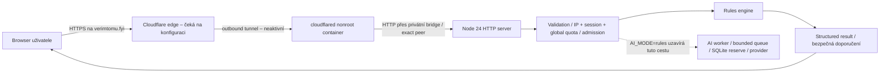

# AIGuard / Věřím tomu? — nezávislý review balíček, Security Gate 1.1

2026-10-08. **SECURITY GATE: BLOCKED.** Tento balíček připravil autor lokální kontroly pro dalšího nezávislého reviewera. Vlastní testy ani doporučení v evidenci nejsou independent sign-off. Žádný deployment/push/DNS/AI activation nebyl proveden. Žádné Accepted Risk nebylo schváleno.

## Rozsah a identita implementace

Repo AIGuard, aktuální pracovní tree. `git rev-parse --verify HEAD` selže: repository je unborn. Po Gate1.1 je nyní celý lokální review kandidát připraven v indexu na větvi `security/gate-1-review`; žádný commit ani push nebyl proveden. Pre-commit kontrola a úplný file list: [PRE_COMMIT_SECURITY_CHECK.md](PRE_COMMIT_SECURITY_CHECK.md). Není schválený úplný Git release. Neoznačovat `main`, lokální tag nebo audit image za schválenou produkci. Po lidském schválení Git scope se musí přezkoumat a znovu sestavit **konkrétní úplný commit**; dnešní review nenahrazuje tento krok.

- **Aktuální review kandidát:** [pre-commit manifest.json](evidence/pre-commit/manifest.json) identifikuje bytes/SHA-256/mode celého kandidáta kromě manifestu samotného; jeho přesný staged Git tree ID je součástí pre-commit předání. [files.txt](evidence/pre-commit/files.txt) obsahuje každý kandidátní path. Není to podpis/provenance ani human approval.
- **Historická Gate1.1 evidence:** [review-source-manifest.json](evidence/gate-1.1/review-source-manifest.json) zůstává původní snapshot 64 source/config/test files. Pre-commit krok rozšířil pouze `.gitignore`; všechny ostatní soubory tohoto historického source manifestu i 36 runtime `/app` souborů audit image stále přesně odpovídají kandidátovi. Původní raw evidence a její SHA manifest se nepřepisují. Nové/aktualizované bezpečnostní dokumenty pokrývá aktuální pre-commit manifest.
- Audit app image: `sha256:32e4dbc56ceb626b4e87e1c39892e7d292bee3aaf702233659619a973051bdc2`.
- Audit connector image: `sha256:3d0a7b710bbced831dc303af25dbb831129834d13f4bdc0d304682dd75f566c9`.
- Pinned bases/build flow: [Dockerfile](../../Dockerfile), [Dockerfile.cloudflared](../../Dockerfile.cloudflared), [deployment.env.example](../../deploy/env/deployment.env.example). Digest není sám o sobě podpis vendoru; SBOM/source-to-binary/provenance je review otázka.
- Evidence podrobnosti a raw hashes: [evidence README](evidence/gate-1.1/README.md), [manifest.json](evidence/gate-1.1/manifest.json). Původní [SCAN_SUMMARY.json](SCAN_SUMMARY.json) zůstává historickým Gate1 záznamem beze změny.

## Architektura současné beta varianty



Jeden Node24 native HTTP proces obsluhuje statický frontend i API; nula externích npm dependencies. Frontend nekomunikuje s LLM. Produkční CMD importuje strict rules-only guard. App container poslouchá uvnitř na 0.0.0.0:3000, publikace pouze host 127.0.0.1:43127. Connector nemá veřejné porty, sdílí ingress bridge s app a samostatný outbound bridge; pouze soubor tunnel tokenu. App nemá secret mount ani persistent AI volume. HTTP-only Tunnel route je **plán**, nikoli ověřená živá konfigurace. VPS není ověřen/připraven, TLS/DNS trust zatím není důkaz.

Služba má GET `/`, `/privacy`, `/app.js`, `/style.css`, 14 přesných PNG, `/api/health`, `/api/session` a POST `/api/analyze`. URL analýza je zpracování URL stringu bez fetch. Žádný PDF/image upload, user account, admin route, share nebo directory listing. `/api/health` vrací jen provozní metadata, není ingress-authenticated a nepodléhá API rate quota; zůstává bounded HTTP admission/connection limity.

Data prochází validation → rules → structured rules result. Implementovaná budoucí AI větev je validation → rules → bounded queue → worker/model routing → reserve před call → JSON schema/safety/evidence verification → structured result; critic jen podmíněně a s novou rezervací. **Nesmí se aktivovat v tomto release.** Fake provider tests nejsou skutečný OpenAI test. Budoucí feature gates viz [DATA_AND_FEATURE_GATES.md](DATA_AND_FEATURE_GATES.md).

## Relevantní zdrojové soubory

| Vrstva | Zdroj | Test / verifier |
|---|---|---|
| HTTP, static allowlist, error response, shutdown | [src/server.js](../../src/server.js), [http-security.js](../../src/http-security.js) | [security.test.js](../../tests/security.test.js), [server.test.js](../../tests/server.test.js), [characters.test.js](../../tests/characters.test.js) |
| Proxy trust, IP normalization, sessions/quotas | [client-ip.js](../../src/client-ip.js), [limits.js](../../src/limits.js) | [ingress.test.js](../../tests/ingress.test.js), [server.test.js](../../tests/server.test.js) |
| Rules / input limits / verification | [analysis.js](../../src/analysis.js), [ai/schema.js](../../src/ai/schema.js) | [analysis.test.js](../../tests/analysis.test.js), [security.test.js](../../tests/security.test.js), [ai.test.js](../../tests/ai.test.js) |
| Guard a dormant AI | [production-config.js](../../src/production-config.js), [production-guard.js](../../scripts/production-guard.js), [ai/runtime.js](../../src/ai/runtime.js), [ai/pipeline.js](../../src/ai/pipeline.js), [ai/provider.js](../../src/ai/provider.js), [ai/budget.js](../../src/ai/budget.js), [ai/queue.js](../../src/ai/queue.js), [ai/errors.js](../../src/ai/errors.js) | [ai.test.js](../../tests/ai.test.js), [provider.test.js](../../tests/provider.test.js), [ai-http.test.js](../../tests/ai-http.test.js), [budget.test.js](../../tests/budget.test.js), [queue.test.js](../../tests/queue.test.js), ingress guard tests |
| Browser rendering/XSS | [public/app.js](../../public/app.js), [index.html](../../public/index.html), [privacy.html](../../public/privacy.html), [style.css](../../public/style.css) | [security-browser.js](../../scripts/security-browser.js), characters tests |
| Runtime isolation/build | [Dockerfile](../../Dockerfile), [Dockerfile.cloudflared](../../Dockerfile.cloudflared), [.dockerignore](../../.dockerignore), [compose.yaml](../../deploy/compose.yaml), [app.env.example](../../deploy/env/app.env.example), [.gitignore](../../.gitignore) | [security-config.js](../../scripts/security-config.js), raw Trivy / filesystem evidence |
| Deploy/rollback | [common.sh](../../deploy/scripts/common.sh), [deploy.sh](../../deploy/scripts/deploy.sh), [rollback.sh](../../deploy/scripts/rollback.sh), [build-connector.sh](../../deploy/scripts/build-connector.sh) | [deploy-scripts.test.js](../../tests/deploy-scripts.test.js); mock Docker CLI, ne reálný deploy |
| Health/smoke | [healthcheck.js](../../scripts/healthcheck.js), [deployment-smoke.js](../../scripts/deployment-smoke.js) | shutdown test, config check; HTTPS smoke čeká |

Všechny požadované bezpečnostní kontroly s konkrétní funkcí, testem a omezením závěru jsou v [ARCHITECTURE_REVIEW.md](ARCHITECTURE_REVIEW.md). Starší kontext: [THREAT_MODEL.md](THREAT_MODEL.md), [CLOUDFLARE_SECURITY.md](CLOUDFLARE_SECURITY.md), [OPERATIONS.md](OPERATIONS.md), [VALIDATION_REPORT.md](VALIDATION_REPORT.md). Přezkoumat **kód**, nikoli jen tvrzení dokumentace.

## Bezpečnostní invarianty, které reviewer musí potvrdit

1. Produkční entrypoint odmítne odchylku od rules-only, zero AI budgets, retry0, critic/localfalse; žádný provider/key/AI state není aktivní. Privilegovaný env/Docker admin je trusted boundary, ne protivník blokovaný guardem.
2. Jediný trusted proxy peer je explicitní IP connectoru; klientský header se bere jen od něj, přesně jeden a validní. XFF/forwarded Host/Proto nikdy neurčují bezpečnostní identitu/origin. Reálný edge musí klientskou IP přepisovat důvěryhodně.
3. Production POST má přesný Host+Origin, validní Secure/HttpOnly/Strict session; cross-site i same-site subdomain odmítá. Session je anonymní kvóta, ne autentizace.
4. HTTP parser nepřijímá CL/TE ambiguity, duplicate critical headers, nejednoznačné/encoded/traversal paths; JSON byte/input limits, UTF-8 a deadlines platí před analýzou. Žádný gzip decompression/upload/fetch.
5. HTTP/analysis/queue admission a RAM key limits jsou bounded; timeout neotevírá nové workery ignorující cancellation. Global API limit platí přes rotaci IP, není trvalý/fleet-wide.
6. Future AI musí rezervovat request i konzervativní cost atomicky **před každým** provider pokusem, včetně critic/retry; nedostupná evidence, nula limitů nebo vyčerpaný budget znamená **žádný provider call**. No refund; ledger nesmí být resetován rollbackem. Multi-host aktivace zakázána bez jiné distribuované evidence.
7. Analyzovaný obsah jsou untrusted data oddělená od system instructions; výstup validuje server, doporučení serverová. Frontend interpretuje text jako text, nikdy HTML modelu.
8. Statické soubory pouze z explicitní mapy; .env/.git/docs/tests nejsou routes, žádný assets wildcard/directory listing; secret nikde client-side.
9. Nonroot/RO/capdrop/NNP/resources/no socket/no hostnet platí pro app i connector; loopback publishing není veřejné. Bridge NAT **není** egress sandbox. Docker host kernel/admin compromise jsou mimo sílu tohoto sandboxu.
10. Logging neobsahuje content, screenshots/docs, API/token secrets ani raw parser packet/error. Toto musí ověřit i skutečný connector/edge/hosting, nejen app response.
11. Deploy/rollback drží flock, používají pouze vlastní projekt/app, exact revision/pins, guard a smoke před saved pointer. Nemění cizí containers/networks/tunnel/ledger; image rollback není rollback konfigurace.
12. Release nemůže přejít na PASS jen kvůli lokálním testům, nule HIGH/CRITICAL nebo sestavitelnému image. Externí review a explicitní schválení jsou nutné.

## Testovací příkazy pro izolované lokální review

Node24, Docker28+ / Compose2 pro config verifier; žádné production secrets. npm scripts nevyžadují externí npm dependencies. Browser test vyžaduje Playwright/Chromium instalované pouze v odděleném development/test prostředí. Nepoužívat `npm run test:live`.

```sh
npm test
npm run check
npm audit --json
bash -n deploy/scripts/common.sh deploy/scripts/deploy.sh deploy/scripts/rollback.sh deploy/scripts/build-connector.sh
node scripts/security-config.js
PLAYWRIGHT_MODULE=<ABSOLUTE_PLAYWRIGHT_MODULE_PATH> CHROMIUM_PATH=<CHROMIUM_EXECUTABLE> node scripts/security-browser.js
gitleaks dir . --config <OFFICIAL_V8_30_1_CONFIG> --redact --report-format json --report-path <OUTSIDE_REPO_REPORT>
```

Trivy0.75.0, **všechny severity** (neomezit evidence na HIGH/CRITICAL), žádné ignorefiles/waivers. Pro reprodukci historického výsledku použít stejnou DB; před schválením release naopak nový feed a zaznamenat nový DB čas, image ID a hash reportu. Trivy default exit0 bez `--exit-code` znamená dokončený scan, nikoli schválení nálezů.

```sh
trivy image --cache-dir <AUDIT_CACHE> --skip-db-update --input <APP_IMAGE_TAR> --scanners vuln --format json --output <APP_REPORT>
trivy image --cache-dir <AUDIT_CACHE> --skip-db-update --input <CONNECTOR_IMAGE_TAR> --scanners vuln --format json --output <CONNECTOR_REPORT>
trivy config --cache-dir <AUDIT_CACHE> --skip-check-update --format json --output <CONFIG_REPORT> <DIRECTORY_CONTAINING_BOTH_DOCKERFILES>
```

Tyto příkazy neaktivují službu/tunnel/AI. Runtime deploy/rollback/HTTPS/edge load a restore drill jsou až separátně autorizovaný staging. Výsledky právě provedených kontrol, omezení a raw evidence: [GATE_1_1_VALIDATION.md](GATE_1_1_VALIDATION.md).

## Nálezy a nevyřešená rizika

Úplný seznam všech **34** nálezů s package version, fix version, runtime/build, trigger, dosažitelností, realistickým dopadem, opravou, doporučením a důkazem: [VULNERABILITY_EVIDENCE.md](VULNERABILITY_EVIDENCE.md). Strojová evidence: [findings.json](evidence/gate-1.1/findings.json).

| Image | MEDIUM | LOW | UNKNOWN | HIGH/CRITICAL | Návrhy rozhodnutí (ne schválení) |
|---|---:|---:|---:|---:|---|
| App | 23 | 8 | 0 | 0 | 18 MITIGATE, 13 INVESTIGATE |
| Connector | 2 | 0 | 1 | 0 | 2 FIX, 1 INVESTIGATE |
| Celkem | 25 | 8 | 1 | 0 | 2 FIX, 18 MITIGATE, 14 INVESTIGATE; 0 ACCEPT |

Obě SSH CVE mají fix v x/crypto0.56.0, ale současná vendor binárka0.55.0 je zlinkovaná se SSH. Priorita je získat a samostatně ověřit opravený vendor image, nikoli odstranit package z reportu. OpenPGP UNKNOWN může být module/subpackage mismatch; absence symbolů není definitivní uzavření. Zlib affected range je v rozporu s Debian really1.3.1 označením, vyžaduje patch/source provenance. libstdc++/libgcc/libc jsou skutečně načteny; GCC source-family matching nelze považovat za automaticky build-only. Pthread/ASLR nálezy mohou kombinovat riziko jiných native chyb.

**CNA versus Trivy:** CVE-2026-102010, CVE-2026-95619, CVE-2026-19499 a CVE-2026-85091 mají v dodaných CNA snapshots rating HIGH (10 package rows), ačkoli Trivy MEDIUM. Úplná evidence uchovává oba ratingy. „0 HIGH/CRITICAL“ platí pouze pro daný Trivy report/feed, nikoli pro všechny advisory zdroje nebo realistický dopad. Tento rozpor a případná native memory-corruption reachability jsou povinnou součástí R13.

**Skutečné release blockery:** R00 (P0: chybí approved complete Git release), R03 (P1: VPS/SSH/firewall), R04 (P1: Cloudflare/TLS/trust), R05 (P1: privacy), R06 (P1: external review/staging/recovery), R13 (P1: nedokončené rozhodnutí o 34 nálezech). Jde o readiness blockers, nikoli tvrzení, že všech 34 CVE je P0/P1 exploitable. Nový potvrzený vzdálený native exploit/secret exposure by gate okamžitě eskaloval. V této kontrole nebyla nová taková cesta prokázána.

Před VPS lze doplnit native/version/provenance review, ověřit opravený vendor connector, zlepšit chybějící parser/session/logging/deploy fault-injection testy, získat externí review, připravit privacy údaje a následně požádat o Git release schválení. V tomto kroku byly připraveny evidence a dokumenty; tyto navržené runtime opravy se automaticky neprovedly.

VPS/Cloudflare potřebují host kernel/Docker/firewall/SSH/secret permissions/resolver, skutečné HTTP-only ingress a client-IP proof včetně Workers/PseudoIPv4, TLS/HSTS/redirect, IPv4+IPv6 scan, constrained staging load, unhealthy alert/recovery, app+connector update/rollback/restore drill a privacy log-retention proof. Ram-only quotas, NAT false positives, no outbound egress sandbox a single-host availability potřebují explicitní rozhodnutí s ownerem/expirací, ne blanket waiver.

## Otázky a požadovaný výstup nezávislého reviewera

1. Jsou všech 34 raw ID/package/version dvojic správně přiřazeny k skutečnému běžícímu kódu? Ověřte GCC source-family, zlib backports/fork a OpenPGP import scope; uveďte vlastní reprodukci a stupeň jistoty.
2. Je HTTP-only connector dostatečně omezen i při remote config změně? Jsou SSH CVE vyřešeny schválenou vendor verzí, nebo je nutná výslovně zdůvodněná jiná kompenzace? UNKNOWN bez datace nepřijímat bez zdroje.
3. Může Node native pathway zpřístupnit libc/PBDS/allocator chyby? Jaká kombinace s NPTL/ASLR nálezy je realistická? Jsou přímé symboly/startup maps dostačující, či je třeba call-graph/source build evidence?
4. Jsou parser/duplicate header/origin/session invariants zachovány za skutečným edge HTTP2/3 forwardingem? Potvrďte cookie tossing/subdomain a IPv6/PseudoIPv4/Workers rizika.
5. Mohou synchronní rules/SQLite (budoucí AI), static image burst nebo unhealthy-but-running proces vyčerpat službu přes limity? Které capacity/persistence/availability kompenzace jsou před betou nezbytné?
6. Je random session secret a RAM quota vhodné pro anonymní rules beta? Jak bude řízen restart abuse/NAT/cookie churn, aniž by vznikla tvrzení o autentizaci?
7. Je isolation dostatečná pro současný rules-only rozsah i s bridge outbound NAT a trusted connector/admin? Jaké egress/kernel/Docker/registry/provenance důkazy jsou nutné?
8. Jsou secrets a guard threat boundary popsány pravdivě včetně NODE_OPTIONS pre-import a Docker root-equivalent? Ověřte, že žádná fáze build/test/runtime ani výstup nese credentials.
9. Zkontrolujte deploy/rollback nejen mock testy: pointer consistency při jednotlivých chybách, config versioning, recovery po failed explicit rollback, connector lifecycle a zachování budoucí budget evidence.
10. Jsou cost reserve/retry/critic maxima, UTC day/lifetime accounting, tariff drift a DB failure opravdu fail-closed? Live AI ani multi-host aktivaci tímto beta review neschvalujte.
11. Jsou runtime/edge/hosting logy bez obsahu/secretů, s nezbytnými metadaty a doloženou retencí? Je veřejná privacy informace přesná a doplněná provozovatelem?
12. U každého otevřeného nálezu uveďte vlastní závěr FIX/MITIGATE/ACCEPT/INVESTIGATE, důkaz, owner, deadline a retest. Potenciální ACCEPT musí samostatně výslovně schválit člověk; žádný P0/P1 waiver nesmí obejít zadání. Potvrďte konflikty zájmů a skutečnou nezávislost reviewera.

Výstup má uvádět reviewer identity/date, scope, konkrétní source/release/image SHA, vlastní testy a omezení, otevřené P0/P1, dispozici **každého** nálezu a podmínky stagingu. Teprve samostatné externí schválení a uzavření ostatních gates může změnit BLOCKED. Zde žádný sign-off neexistuje.
