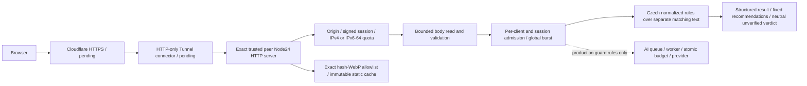

# AIGuard — independent retest package, Remediation 1

**SECURITY GATE: BLOCKED.** Připraveno implementujícím autorem pro nezávislého reviewera. Tento dokument ani naše testy nejsou nezávislé schválení. Původní Claude review je samostatné AI review; lidský security sign-off stále čeká.

## Přesný rozsah

- Base / aktuální HEAD: `fde14ba57d62ba9e6aab0181170386a1d38da7a1`.
- Lokální větev `security/gate-1-remediation`; opravy jsou **uncommitted**, bez merge, deploymentu nebo push.
- Imported review commit: `1e26f6c957e752eef86aa3227839efa64121dfaa`, parent přesně base. Importovány pouze dva soubory, **byte-for-byte**:
  - [CLAUDE_INDEPENDENT_REVIEW.md](CLAUDE_INDEPENDENT_REVIEW.md), SHA-256 `eedc7f15a8cc820b3276e0d35bb94eb32099f75568d2fa24e840d8892d62eef9`.
  - [claude-review.adversarial.mjs](../../tests/adversarial/claude-review.adversarial.mjs), SHA-256 `94eabe970bc359b2fc03e5ea70cca199524c432e680af4eb3a31d5ffcb2bc748`.
- [Current candidate manifest](evidence/cr03-stability/candidate-manifest.json) a [paths](evidence/cr03-stability/candidate-files.txt) popisují konkrétní současné bytes, včetně dokumentace a assetů. Self-manifest/vlastní file list jsou výslovně vyloučeny kvůli self-reference. Nejde o podpis ani approved Git tree.
- [Runtime comparison](evidence/remediation-1/image-source-comparison.json) je historický: po CR03 stability fix již změněný `src/analysis.js` neodpovídá této audit image. Nový exact-candidate build/runtime/hash check čeká; revision `unreleased` není approved commit. Frozen evidence se nepřepisuje.
- [CR03 stability remediation](CR03_STABILITY_REMEDIATION.md): zachovaná selhání 92.124/46.843ms a meziverzí; finální 30/30 pod nezměněným 20ms limitem, 90/90 testů a strict Claude16/16. Review normalization fast paths, Unicode property domain a token boundaries; nejde o externí sign-off.

Po schváleném commit/push lze provést nový clone/retest přesného nového SHA. Nyní nelze z remote clone získat tyto necommitnuté opravy; reviewer může zkontrolovat lokální diff a current file manifest.

## Architektura



Jeden native Node24 proces, nula runtime npm dependencies, frontend bez bundleru. ES module `app.js` používá exact asset mapping. App port3000 uvnitř jediné **internal bridge**, **žádný published host port**. Connector má tuto bridge + vlastní egress, token file pouze v connectoru; app žádný token/key/budget volume. **Internal bridge nezakazuje host gateway/same-bridge traffic**: povinné host+bridge egress enforcement a staging test. Outbound Tunnel / TLS / DNS / WAF nejsou nyní aktivovány.

GET public HTML/CSS/JS, explicitních 14 immutable WebP a 14 legacy301 aliasů, health/session; POST JSON analysis. Unknown/static/internal/docs/env/Git/uploads 404. URL se nestahuje. No-JS/module failure: disabled submit, POST target, vstupní pole nemají `name`, takže ani native form submission nemůže poslat obsah. Žádné user history/database/content logging.

## Relevantní soubory, funkce a assertions

| Control | Zdroj / funkce | Test |
|---|---|---|
| HTTP parser, framing/routing/headers | `src/http-security.js`: checkRequestHeaders, requestPath, readJson; `src/server.js`: createServer/clientError | `tests/security.test.js`; 7 původních Claude invariantů |
| Origin/CSRF/trusted IP | checkBrowserRequest; `src/client-ip.js`: clientIpResolver/normalizeIp | `tests/ingress.test.js`, security production origin/forged headers, Claude cookie/Origin assertions |
| /64 fairness, bounded quotas/state | clientIdentity; `src/limits.js`: WindowLimiter; createServer/session branch | `tests/remediation.test.js` CR01 a Claude CR01/01b |
| Slow bodies/concurrency/cancellation | ClientAdmission, readJson, createServer acquisition order/work.finally | remediation CR02; security slow body/ignored cancellation; Claude CR02 |
| Sessions/cookies | AnonymousSessions.validId/get/sign | ingress/server/security sessions; remediation CR06; Claude forged/expired/wrong-key/shadow cases |
| Rules bounds/normalization/neutrality | `src/analysis.js`: matchingRepresentation, orderedPhrase, intakeAgent, fraudAgent, resultLevel/resultSummary | analysis/security ordered rules, remediation CR03–05, Claude CR03–05 |
| Static byte/request budgets, integrity/cache | createServer characterFiles/characterAliases/staticFiles; `public/character-assets.js`; `scripts/optimize-characters.py` | characters/remediation CR07; Claude CR07; full delivery decode+alpha generation checks |
| Browser no-JS/privacy/XSS/roles | `public/index.html`, `public/app.js`: initialize/render/submit; `scripts/security-browser.js` | Chromium1440/390/320, JSdisabled, module failure/native empty POST, textContent injection, URL/zero signal neutral states |
| Logging | server serviceError/clientError/shutdown and fixed metadata output | remediation captured child stdout/stderr markers; VPS/CF retention remains untested |
| Docker/secrets/network | `Dockerfile`, `.dockerignore`, `deploy/compose.yaml` | security-config; exact image/runtime export; isolated bridge/gateway proof |
| Release/rollback identity | deploy/scripts common.verify_image/activate_image/save_image; deploy.sh/build-connector.sh/rollback.sh | `tests/deploy-scripts.test.js`: cached tag forces build, archive vs dirty source, immutable ID mismatch/missing IID, scoped activate/smoke/lock/rollback failures |
| Cost fail-closed / dormant AI | `src/production-config.js`: assertRulesProduction; ai/runtime createRuntime; ai/pipeline TextAIWorker; budget.reserve; queue.submit; provider.complete; schema.validateOutput | original AI/provider/queue/budget tests incl4 parallel reserve workers, remediation provider-original-content/template summary/production zero guard |
| Independent suite cannot hide TODO failures | `scripts/claude-review-check.js` | asserts immutable suite SHA; rejects every TAP `not ok`, nonzero, missing assertions or skips |

Full source paths/hashes jsou v candidate manifestu. Nepřezkoumávat pouze wrapper výsledky: reviewer má spustit i raw nezměněný Claude soubor a přezkoumat každý assertion.

## Invarianty

1. Production rules only, nulové budgety, žádné známé AI keys, retries0/criticfalse/localfalse. Client nemůže měnit provider/model/endpoint/ceny/režim.
2. Browser JSON stejného exact origin, platná HMAC __Host- session; trusted CF header pouze od exact peer, nikdy XFF fallback.
3. IP identity v quotas je IPv4 nebo IPv6 /64, HMAC pouze RAM. Session identity je nezávislá. Client checks před shared analysis burst; session/invalid body/origin nečerpá global.
4. Body64KiB / content10kchars+16kUTF8bytes, strict UTF8, body deadline2s. Global HTTP64/conn128, body2/client+1/session, analysis2/client+1/session+8global. Worker ignorující abort drží slot do skutečného konce.
5. Original input zůstává exact; NFKC/ignorables/mixed-token confusables pouze matching representation. Žádná transliterace samostatných Cyrillic/Greek slov. Není slib obecné detekce všech jazyků.
6. URL/zero signal/nízké score bez dostatečných signálů je `unassessed`, neutrální postava a text; žádné potvrzení bezpečnosti.
7. Pouze hash-addressed WebP jsou immutable/cacheable; HTML/API/JS/CSS/errors no-store; žádná generic /assets wildcard. Canonical PNG/reference bytes v Git nezměněné, originály neodesílá runtime.
8. Žádný user content v stdout/stderr, DB, client storage, image logs nebo chybách. Edge/host logs vyžadují samostatné ověření.
9. Clean approved Git archive vždy build, aktivace pouze captured immutable image ID; cached mutable tag/label není source provenance. Privilegovaný Docker admin/build daemon je trusted boundary.
10. Scope enlargement ruší native NOT AFFECTED závěry. Žádná suppression, Approved Risk nebo independent sign-off od implementujícího autora.

## Příkazy pro retest

```sh
npm ci --ignore-scripts --no-audit --no-fund
npm test
npm run check
node --test --test-reporter=tap tests/adversarial/claude-review.adversarial.mjs
node scripts/claude-review-check.js
node scripts/security-config.js
PLAYWRIGHT_MODULE=<installed-playwright-module> CHROMIUM_PATH=<chromium> node scripts/security-browser.js
python3 scripts/optimize-characters.py  # dev-only Pillow12.3.0/WebP; original hashes must stay unchanged
bash -n deploy/scripts/common.sh deploy/scripts/deploy.sh deploy/scripts/rollback.sh deploy/scripts/build-connector.sh
npm audit --omit=dev
```

Docker build a Trivy/Gitleaks příkazy a přesné výsledky: [validation](REMEDIATION_1_VALIDATION.md), [evidence README](evidence/remediation-1/README.md). Pouze izolovaný local audit, nikoli deployment. Network probe nesahá na skutečné metadata služby ani produkční host; dokládá známou mezeru interní bridge. Pro raw Claude runner Node bude stále vykazovat **7 pass + 9 TODO labels**, i když všech16 assertions splní; **strict wrapper nepropustí žádné selhání TODO**. Nula skips.

## Nálezy, nevyřešená rizika a otázky

- [CR01–11 dispositions](REMEDIATION_1_REPORT.md); CR01–10 baseline reproduced, CR11 partial (future cost fairness/output steering, nikoli rozbitý global monetary cap).
- [34 package findings](VULNERABILITY_REMEDIATION_1.md): 24 scoped NOT AFFECTED, 8 MITIGATED, A28/A31 OPEN. Tyto proposals nesnižují raw count, CNA severity ani potřebu externího review.
- CR09: jak vynutit a ověřit deny-new app egress i pro host/same bridge/IPv6/recreated container? Internal bridge samotná nestačí.
- Je per-/64 + session fairness přiměřená NAT? Je LRU churn + global burst + CF protection dostatečný pro distributed spike a cold-cache static traffic?
- Jsou regexy skutečně bounded po NFKC expansion a při 0.5CPU? Lokální wall-time není production latency SLO.
- Vyhodnotit false positives confusable/ignorables v legitimním textu, nested/unicode JSON a nativní parser povrchy.
- Potvrdit no-JS/module failure/native-submit leak protections i v jiných prohlížečích; absence logmarkeru v app není edge privacy proof.
- Nezávisle potvrdit all-ELF imports, inlined PBDS/header provenance A28, zlib Debian/fork provenance A31 a *exact binary* affected Go symbols; GNU nm výsledky nejsou govulncheck všech budoucích vendor builds.
- Jsou always-build/captured image ID/guard/manifest/rollback pointer semantics správné při Docker/Git/config failure? Mock CLI není VPS rollout proof; image-only rollback nevrací config nebo budget ledger.
- Budoucí AI: per-identity persistent cost reservations, busy DB mimo HTTP loop, retries/critic/timeout/lifetime caps/idempotency, schema/evidence/semantic attacks na všechny model texty, nejen summary. AI zůstává uzavřená.
- Monitoring unhealthy bez Docker-socket autoheal, skutečný rollback/restore, provider token/CF admin trust, legal privacy a weekly CVE monitoring čekají.

Reviewer uvede identity/date/exact scope/SHA/hash, vlastní výsledky a limity, všechny P0/P1, explicitní CVE dispozice a podmínky dalšího kroku. **Pouze externí schválení + infrastructure gates mohou změnit BLOCKED.**
